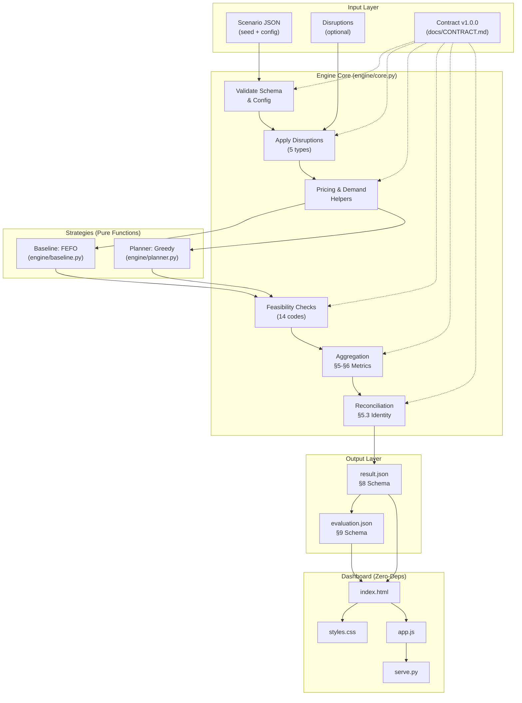
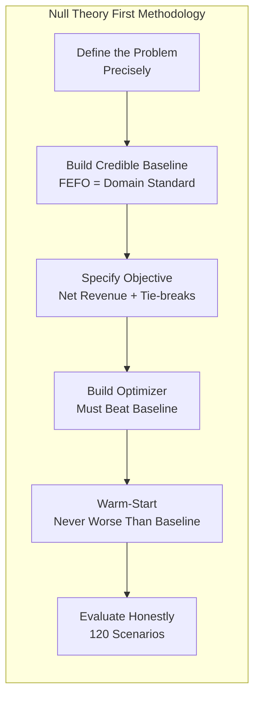
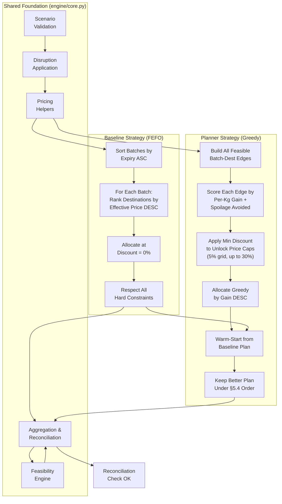
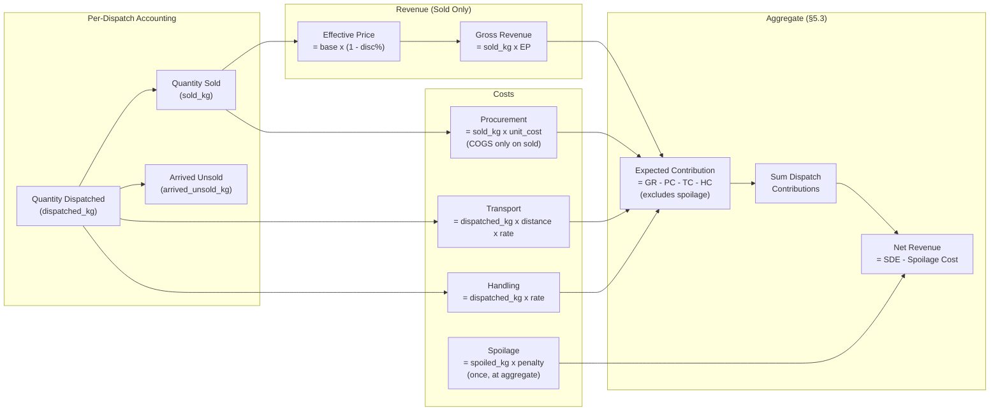
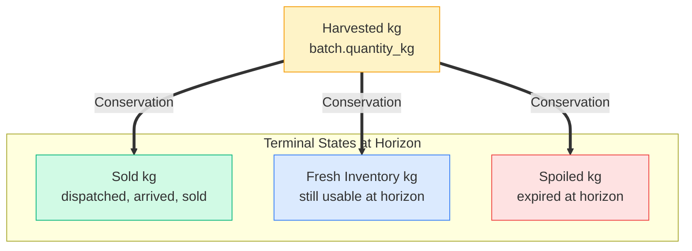
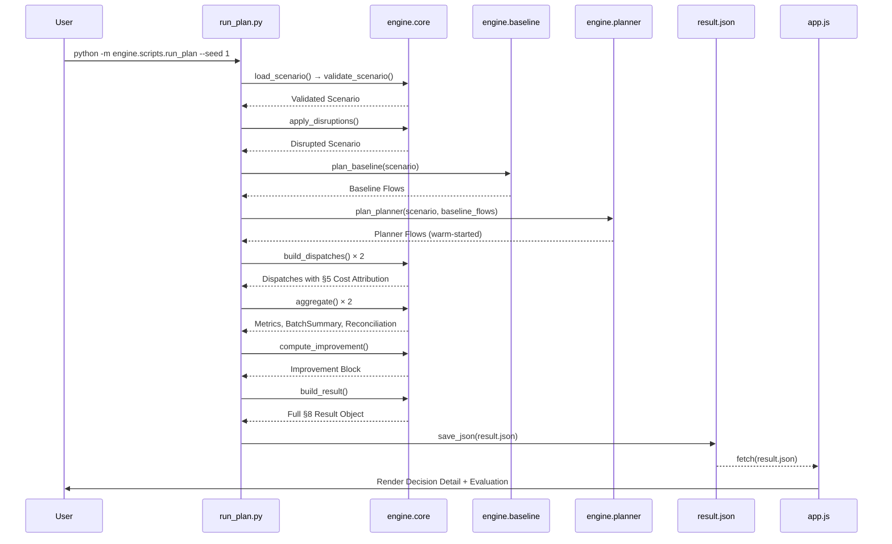
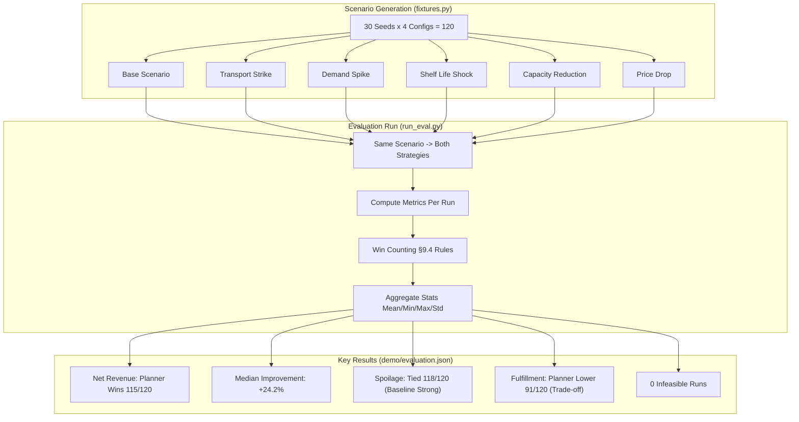
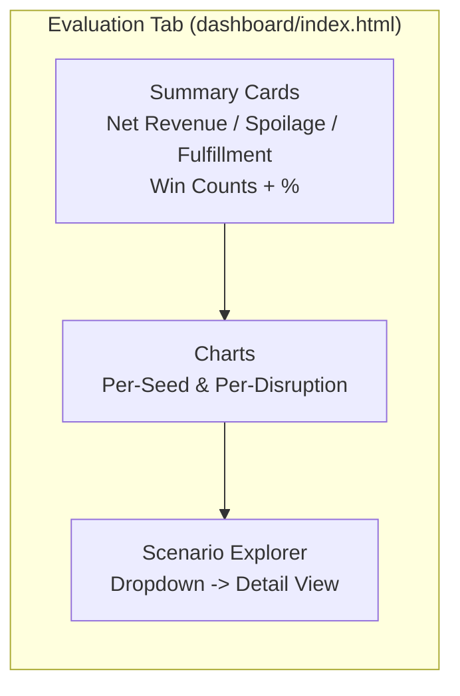
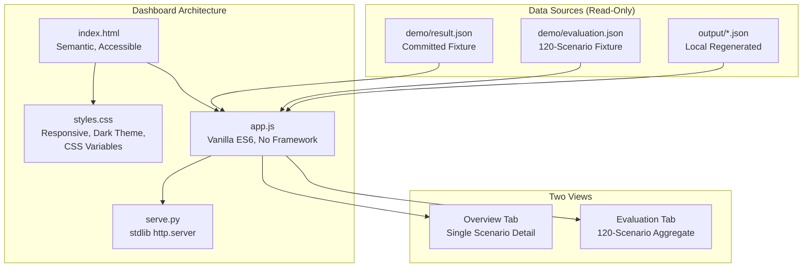
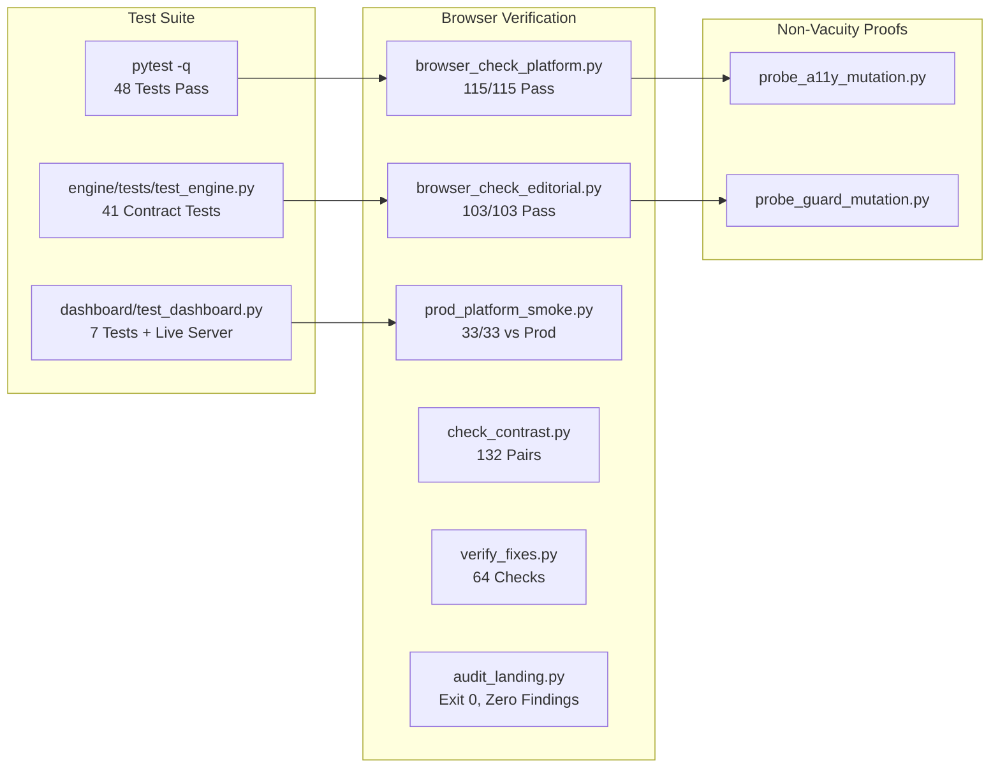

# Aurenza

> **The Null Theory First Project** — An explainable produce allocation & dispatch planning engine for perishable fruits and vegetables.

Aurenza compares a deterministic **FEFO baseline** against an optimizing **planner**, allocating harvested inventory to feasible retail/wholesale destinations while respecting shelf life, demand, capacity, transport & handling costs, discounts, and disruptions — and explains every dispatch.

> **Governing reference:** [`docs/CONTRACT.md`](docs/CONTRACT.md) **v1.0.0-draft.4** (status: PROPOSED — NOT FROZEN)  
> **Assumptions & clarifications:** [`docs/ASSUMPTIONS.md`](docs/ASSUMPTIONS.md)

---

## TL;DR — Why This Project Matters

| Aspect | What We Built |
|--------|---------------|
| **Problem** | ₹92,651 crore annual post-harvest losses in India (NABCONS 2022) — perishables routed by intuition, not optimization |
| **Approach** | Null Theory First: build a *credible baseline* (FEFO) first, then an optimizer that must *provably beat it* on net revenue |
| **Engine** | Pure Python stdlib — deterministic, auditable, zero runtime deps |
| **Strategies** | **Baseline** (FEFO: earliest expiry → highest price) vs **Planner** (greedy by per-kg gain + spoilage avoidance, warm-started from baseline) |
| **Contract** | Formal schema v1.0.0-draft.4 governing input/output/feasibility — engine, dashboard, and evaluation all conform |
| **Evaluation** | 120 scenarios (30 seeds × 4 disruption types), median **+24.2% net revenue**, 0 infeasible runs |
| **Dashboard** | Dependency-free, accessible, dark-theme UI reading *only* generated JSON — no engine coupling |

---

## Architecture Overview



---

## Core Concepts — Visualized

### 1. The Null Theory First Principle



### 2. Baseline vs Planner — Decision Flow



### 3. Cost & Revenue Model (§5)



### 4. Inventory Conservation (§1.4)



**Invariant (enforced by test T1):**
```
harvested_kg == sold_kg + fresh_inventory_kg + spoiled_kg   (±0.001 kg)
```

---

## Data Flow — End to End



---

## Evaluation — 120 Scenarios, Honest Numbers



### Evaluation Dashboard View



---

## Dashboard — Zero Dependencies, Full Fidelity



### Dashboard Features

| View | What You See |
|------|--------------|
| **Overview** | KPI cards (Net Revenue, Spoilage, Fulfillment), both dispatch tables with quantities, destinations, discounts, reasons, batch inventory & spoilage table, accounting reconciliation |
| **Evaluation** | Aggregate win counts across 120 runs, per-metric charts, scenario selector with per-scenario drill-down |

---

## Quick Start

### Prerequisites
- **Python 3.11+** (stdlib only — no pip install needed for engine)
- `pytest` for tests (`pip install pytest`)

### Run Everything

```powershell
# 1. Run the full test suite (48 tests: 41 engine + 7 dashboard)
python -m pytest -q

# 2. Generate the committed demo output (baseline vs planner, one scenario)
python -m engine.scripts.run_plan --seed 1

# 3. Regenerate the multi-seed evaluation summary (120 scenarios)
python -m engine.scripts.run_eval

# 4. Open the dashboard (serves repo root on 127.0.0.1:8000)
python dashboard/serve.py
# Then open http://127.0.0.1:8000/dashboard/
```

### Outputs Generated

| File | Description |
|------|-------------|
| `demo/result.json` | One generated demo scenario, both strategies (committed fixture) |
| `demo/evaluation.json` | 120 scenarios, aggregate stats (committed fixture) |
| `output/<scenario_id>/result.json` | Per-scenario outputs (gitignored, regenerable) |
| `output/evaluation.json` | Same as demo/evaluation.json (gitignored) |

> **All outputs are produced by the real engine** — they are synthetic demo data from labelled fixtures, not observed real-world performance.

---

## Repository Structure

```
Aurenza/
├── docs/
│   ├── CONTRACT.md          # Interface contract v1.0.0-draft.4 (source of truth)
│   └── ASSUMPTIONS.md       # Assumptions, clarifications, open items (A9)
├── engine/
│   ├── core.py              # Shared logic: validation, disruptions, pricing, aggregation, feasibility, reconciliation
│   ├── baseline.py          # FEFO baseline strategy
│   ├── planner.py           # Greedy planner strategy (warm-started from baseline)
│   ├── fixtures.py          # Deterministic synthetic scenario generator
│   ├── scripts/
│   │   ├── run_plan.py      # Single-scenario CLI → result.json
│   │   └── run_eval.py      # Multi-seed evaluation CLI → evaluation.json
│   └── tests/
│       └── test_engine.py   # Contract test suite (41 tests)
├── dashboard/
│   ├── index.html           # Markup (semantic, accessible, no framework)
│   ├── styles.css           # Styling (responsive, dark theme, CSS vars)
│   ├── app.js               # Logic — reads generated JSON only (no engine import)
│   ├── serve.py             # stdlib static server
│   └── test_dashboard.py    # Dashboard tests (7 tests, includes live server test)
├── demo/
│   ├── result.json          # Committed generated demo output (seed 1)
│   └── evaluation.json      # Committed generated evaluation (120 scenarios)
├── output/                  # Gitignored generated outputs (regenerable)
└── README.md                # This file
```

---

## CLI Reference

```powershell
# Single scenario
python -m engine.scripts.run_plan [--seed N] [--scenario PATH] [--out PATH] [--also-output]

# Multi-seed evaluation
python -m engine.scripts.run_eval [--mode dev|standard|large] [--out PATH]
```

| Flag | Description |
|------|-------------|
| `--seed N` | Scenario seed (default: 1) |
| `--scenario PATH` | External scenario JSON instead of generated fixture |
| `--out PATH` | Output path (default: `demo/result.json` or `demo/evaluation.json`) |
| `--also-output` | Also write `output/<scenario_id>/result.json` |
| `--mode` | `dev`=10 seeds, `standard`=30 seeds, `large`=200 seeds |

---

## Constraints Enforced (§11) — All Tested

| Code | Constraint |
|------|------------|
| `unknown_disruption_type` | Every disruption type in documented enum |
| `negative_quantity` | All quantities ≥ 0 |
| `inventory_exceeded` | Σ dispatched per batch ≤ harvested |
| `capacity_exceeded` | Σ allocated per destination ≤ capacity |
| `demand_exceeded` | Σ sold per dest/produce ≤ effective demand |
| `shelf_life_expired` | Remaining at arrival ≥ min_arrival_shelf_life_days |
| `arrival_after_horizon` | dispatch_day + transit_days ≤ horizon_days |
| `discount_out_of_range` | 0 ≤ discount_pct ≤ eligible_max_pct |
| `discount_step_mismatch` | discount_pct on step_pct grid |
| `invalid_near_expiry_days` | near_expiry_days ≥ 0 |
| `unsupported_destination_type` | type ∈ {retail, wholesale} in v1 |
| `unknown_reference` | All batch_id/destination_id/produce exist |
| `inventory_not_conserved` | §1.1 identity holds per batch |
| `cost_reconciliation_failed` | §5.3 identity holds within ₹0.01 |

**Feasibility is a prerequisite for any success claim.** A strategy that improves a headline metric while violating a constraint is reported as infeasible and cannot be counted as a win.

---

## Verification — All Green



### Run Verification Locally

```powershell
# Unit tests (from repo root)
python -m pytest -q                    # 48 tests

# Dashboard tests (from worktree)
# Note: pytest from repo root picks up old engine on sys.path
# Use the worktree: C:\Users\theni\AppData\Local\Temp\opencode\aurenza-ui
cd C:\Users\theni\AppData\Local\Temp\opencode\aurenza-ui
python -m pytest dashboard -q          # 10 tests
python -m pytest -q                    # 77 tests
```

---

## Key Design Decisions (From Contract)

| ID | Decision | Impact |
|----|----------|--------|
| **A1** | Unsold stock held if fresh at horizon; spoiled only when expired | No double-counting, realistic inventory |
| **A2** | `min_arrival_shelf_life_days = 0.5` default | Configurable quality floor |
| **A3** | Demand response OFF by default | Discounts don't invent demand |
| **A4** | Sales allocation = highest effective price first | Deterministic, fair |
| **A5** | Handling cost on dispatched_kg | Matches physical reality |
| **A6** | Single-day horizon (`horizon_days = 1`) | Simplicity, fresh inventory reported separately |
| **A7** | Discounts: near-expiry only, 5% grid, ≤30%, justified | Prevents gaming, auditable |
| **A8** | Evaluation sizes: dev=10, standard=30, large=200 | Reproducible scales |
| **A11** | Procurement COGS on sold_kg only; spoilage penalty separate | No double-counting (test T16) |
| **U3** | Planner objective: max net_revenue → min spoilage → max fulfillment | Clear, contract-specified ordering |
| **U4** | Donation/processing out of scope for v1 | Focus on sales destinations |

> **Open:** **A9** — Produce catalogue & prices (owner: Iffa). Current `engine/fixtures.py` uses synthetic placeholders.

---

## Honest Limitations

| Limitation | Status |
|------------|--------|
| **Synthetic data only** | `engine/fixtures.py` clearly labelled; real data awaits A9 |
| **Disruption effects provisional** | Contract names 5 types but not parameters (see ASSUMPTIONS.md) |
| **Baseline undefined by contract** | FEFO is team decision; strong baseline = honest comparison |
| **Planner not globally optimal** | Bounded deterministic heuristic, not combinatorial search |
| **Spoilage reduction typically 0** | FEFO already dispatches expiring stock first — planner gain is net revenue |
| **`notes="no_demand"` absent from §8 schema** | Engine omits to stay schema-exact (CLARIFICATION-1) |

---

## Roadmap

| Phase | Deliverable | Status |
|-------|-------------|--------|
| **v1.0 (Current)** | Contract v1.0.0-draft.4 | PROPOSED |
| | Engine + Baseline + Planner | IMPLEMENTED |
| | Dashboard + Tests | IMPLEMENTED |
| | 120-Scenario Evaluation | COMPLETE |
| **v1.1 (Next)** | Freeze Contract v1.0.0 | PENDING REVIEW |
| | A9 Produce Catalogue (Iffa) | OPEN |
| | Real Market Data Integration | PLANNED |
| **v2.0 (Future)** | Multi-Day Horizon | DESIGNED |
| | Stochastic Demand | RESEARCH |
| | ML-Assisted Price Forecasting | EXPLORATORY |
| | Multi-Objective Pareto | EXPLORATORY |

---

## Contributing

1. **Read the contract first** — `docs/CONTRACT.md` is the source of truth
2. **Run tests before changing** — `python -m pytest -q`
3. **Follow the Null Theory First principle** — any new strategy must beat the baseline on net revenue
4. **Maintain determinism** — same seed = byte-identical output
5. **Update tests** — every new constraint code needs a test (§11, §14)

---

## License

MIT License — see `LICENSE` (to be added).

---

## Acknowledgments

- **Nidhi** — Engine architecture, contract, baseline, planner, evaluation
- **Arati** — Dashboard (HTML/CSS/JS), accessibility, visual design
- **Iffa** — Data & evaluation (A9 produce catalogue, market data) — *open*

---

## Live Demo

**Production:** https://aurenza-five.vercel.app  
**Dashboard:** `/dashboard/` (after running `python dashboard/serve.py`)

---

> **Built with Null Theory First discipline.**  
> *Baseline first. Optimizer second. Honest evaluation always.*